# ESP32 Wi-Fi Room Thermostat — Master + Slave

A wireless room thermostat for controlling a boiler or another heating device equipped with a volt-free control input.

The system consists of two modules communicating over a local Wi-Fi network. **It does not require cloud services or internet access.**

## Thermostat Main Screen

The Master's main screen displays:

- Current room temperature
- Target temperature
- Hysteresis
- Humidity
- Atmospheric pressure
- TCP connection status
- Wi-Fi signal strength
- Arrows indicating trends in the measured values

### 1. Connection Status

The top of the screen displays the connection status and Wi-Fi signal strength. The left side shows the status of the Slave (the module installed near the boiler), while the right side shows the status of the Master thermostat.

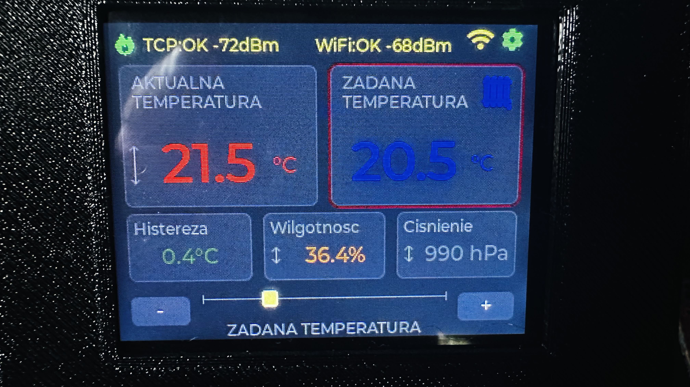

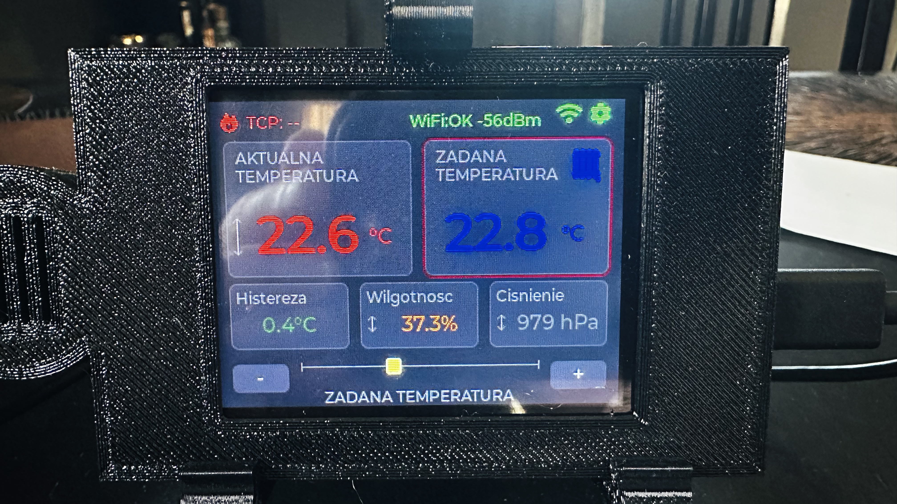

### 2. Temperature and Hysteresis Adjustment

Tapping the "Target Temperature" field allows you to adjust the desired temperature using the slider at the bottom of the screen. Tapping the "Hysteresis" field allows you to adjust the hysteresis using the same slider.

### 3. Humidity

The color of the displayed humidity value indicates whether the humidity level is within the recommended comfort range or outside the recommended values for residential environments.

### 4. Heating Status

The radiator icon next to the "Target Temperature" field indicates the heating status.

🔵 **Blue — heating OFF**


🔴 **Red — heating ON**

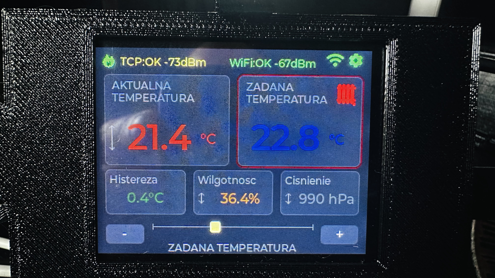

The icon color represents the relay control state, not a direct measurement of the boiler burner's operation.


## Components

**Master — room controller**
- NiceMCU-32S-DEV 2.8IPS with an ESP32 microcontroller.
- Color 320 × 240 IPS ST7789 display.
- CST816D capacitive touchscreen.
- BME280 sensor measuring temperature, humidity, and atmospheric pressure.

**Slave — actuator module**
- ESP32-C3 SuperMini.
- 5 V relay module with an active-LOW input.
- BC337 NPN transistor controlling the relay input.
- 230 V AC → 5 V DC power supply.

## How does it work?

The Master measures room temperature and compares it with the target temperature and configured hysteresis. Based on this comparison, it sends the Slave a command to switch the boiler control relay on or off.

The touchscreen allows you to change the target temperature and hysteresis and view temperature, humidity, atmospheric pressure, TCP connection status, and the Wi-Fi signal strength of both devices.

The modules communicate through an **encrypted TCP connection over the local Wi-Fi network**. Initial setup uses Bluetooth Low Energy (BLE) to authenticate the Slave and securely transfer the network credentials.

When connecting to Wi-Fi, the Slave searches for the access point with the strongest signal for the configured network, making operation in a Wi-Fi Mesh environment easier.

### Protection against connection loss

Short communication interruptions do not immediately turn off the heating.

If valid commands are no longer received, the Slave retains the current relay state until the configured fail-safe timeout expires. It then performs the selected action:

- **OFF** — turn the relay off.
- **ON** — turn the relay on.
- **LAST STATE** — leave the relay state unchanged.

The timeout can be set to **1–30 minutes** (10 minutes by default). The settings are transferred from the Master to the Slave and saved in the device's memory.

When the Slave starts without having received a command, the relay is initially OFF.

## Apple HomeKit and Home Assistant integration

The Master supports Apple HomeKit, allowing temperature readings and target temperature changes from an iPhone or Home Assistant using the HomeKit Device integration.

Basic boiler control remains local and does not depend on internet access or external services.

## AES-256 encryption key

**Before flashing the firmware, generate your own random AES-256 key.**

The key must be 32 bytes long and placed in `SecureLink.h`:

```cpp
static const uint8_t KEY[32] = {
    // Insert 32 bytes of your generated key here
};
```

The same key must be used in the firmware of **both the Master and the Slave**. Otherwise, authentication and encrypted communication will not work.

Generate a key in PowerShell:

```powershell
$key = New-Object byte[] 32
[System.Security.Cryptography.RandomNumberGenerator]::Fill($key)
($key | ForEach-Object { "0x{0:x2}" -f $_ }) -join ", "
```

Generate a key in Bash:

```bash
openssl rand -hex 32 | sed 's/../0x&, /g; s/, $//'
```

Do not publish the key in a public Git repository.

## Why NiceMCU instead of ESP32-CYD?

The original thermostat ran on the popular **ESP32-CYD (Cheap Yellow Display)** board with a 320 × 240 touchscreen and a built-in light sensor. The latter works inconsistently on some Chinese boards. :)

Because of the limited available RAM — the program was already running with almost no headroom — I decided to switch to the **NiceMCU-32S-DEV 2.8IPS** board.

The price is similar, but the new board offers a slightly better IPS display and a CST816D capacitive touchscreen, which I handle without an additional touch library. This reduced RAM usage.

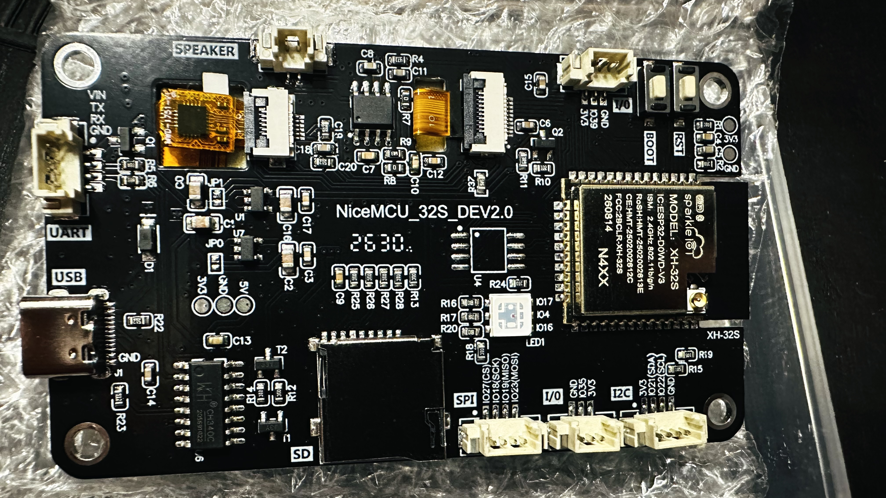

The BME280 sensor is connected to the socket labeled I2C.

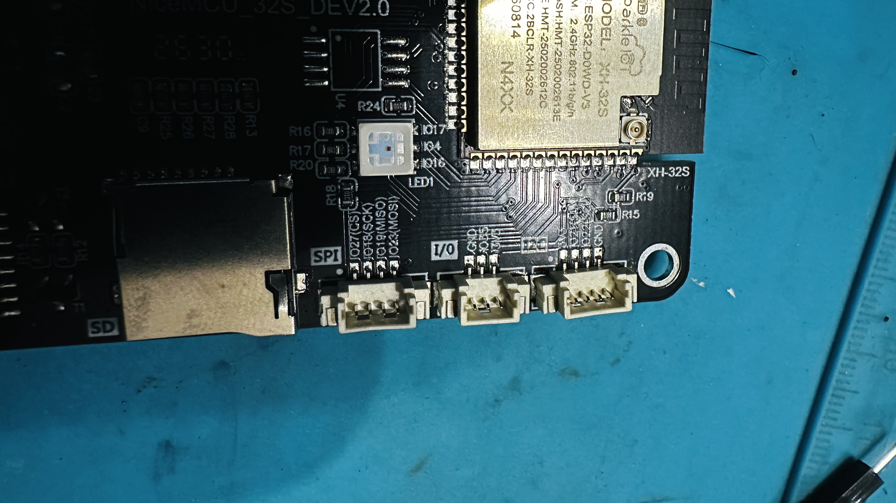

## Slave actuator module

For the actuator module installed near the boiler, I used:

- ESP32-C3 SuperMini.
- 5 V relay module triggered by a LOW signal.
- BC337 transistor.
- 10 kΩ resistor.
- 230 V AC → 5 V DC power supply module.

The BC337 transistor is connected as follows:

- **Base** — ESP32-C3 GPIO4 through a 10 kΩ resistor.
- **Collector** — relay module IN input.
- **Emitter** — circuit ground.

The ESP32-C3 and relay module grounds must be connected together.

Thanks to the transistor, a HIGH signal on GPIO4 pulls the relay input LOW.

The circuit is simple enough that I probably don't need to draw a schematic. :)

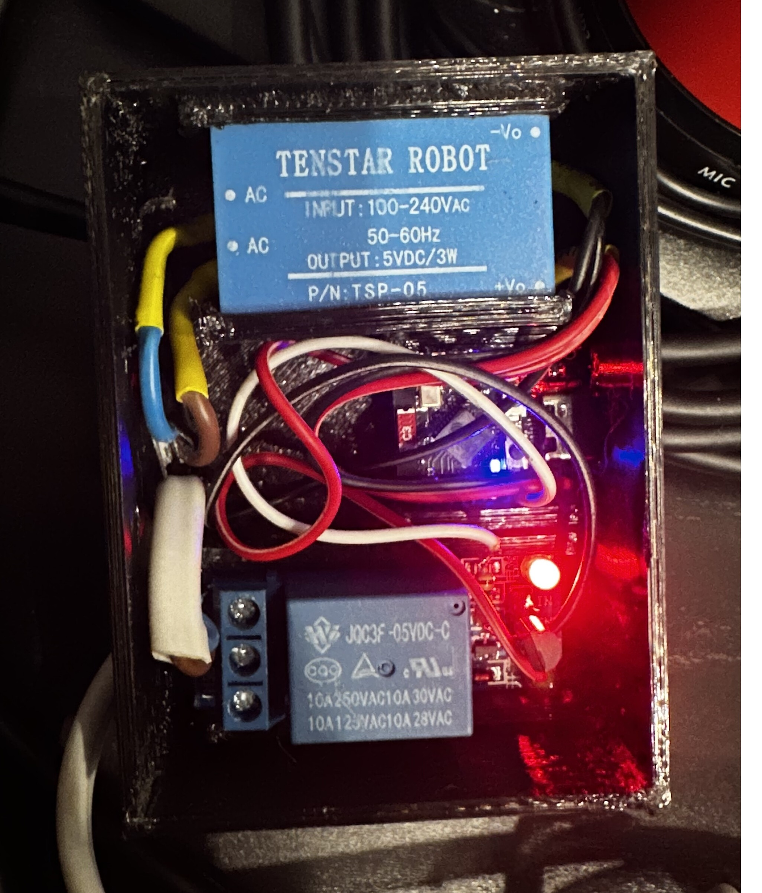

## How the entire system works

When configuration starts, the Master discovers the Slave via BLE and authenticates it using the shared encryption key. It then sends the Wi-Fi network name and password.

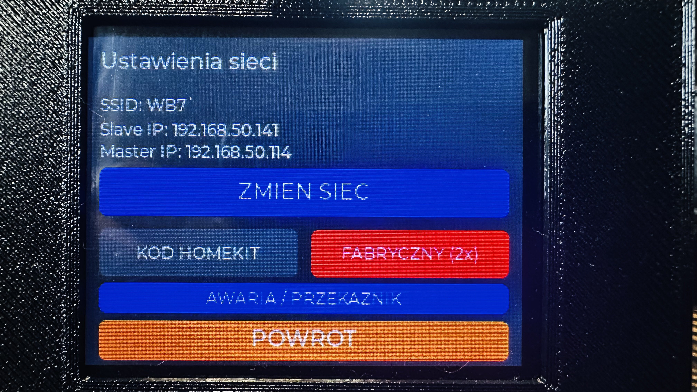
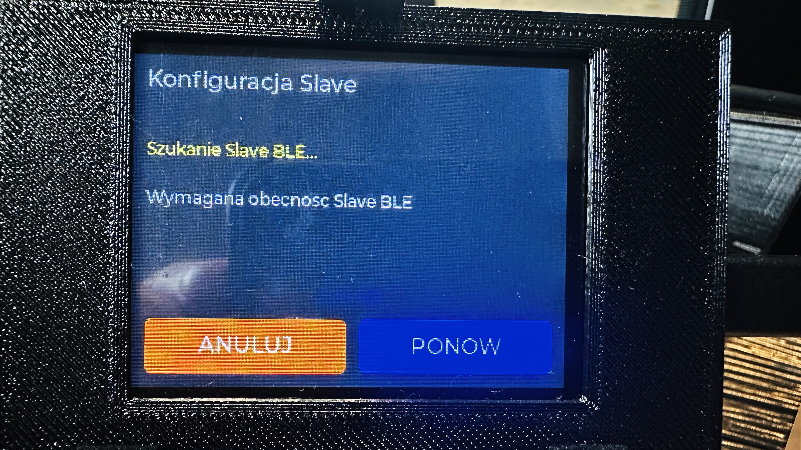

After joining the network, the Slave starts a TCP server, and the Master establishes an encrypted communication session with it.

The Master periodically reads the temperature from the BME280. If it falls below the target temperature minus the hysteresis, the Master sends a command to turn the heating on. If it rises above the target temperature plus the hysteresis, the Master sends a command to turn the heating off.

The Slave executes the commands by controlling the relay and sends acknowledgements. The Master displays the connection status and Wi-Fi signal strength.

If communication is lost, the Slave follows the previously configured fail-safe mode. This means heating control does not depend on the Master being continuously available.

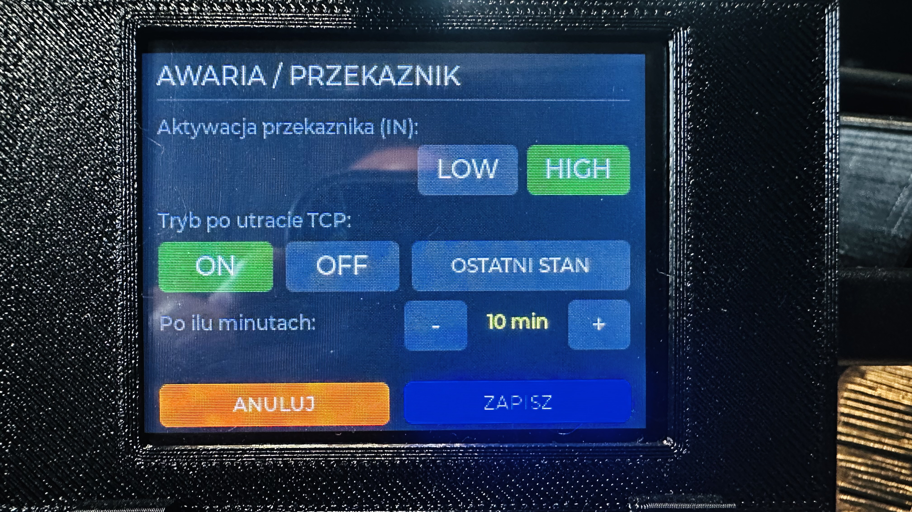

The complete enclosures are made from these 3D-printed parts.

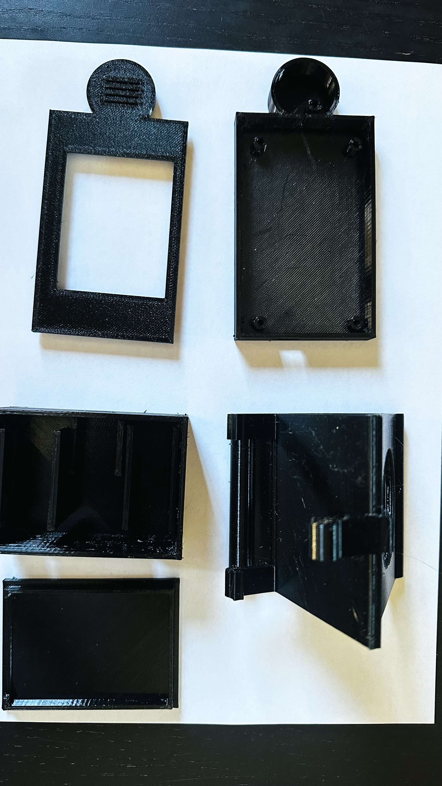

## First startup

1. Flash the Master and Slave firmware with the same key in `SecureLink.h`.
2. Turn on both devices within range of a stable Bluetooth connection.
3. Start network configuration on the Master.
4. Once the Slave has been discovered and authenticated, select the Wi-Fi network and enter its password.
5. After configuration, the devices communicate over the local Wi-Fi network.

BLE is used for configuration, not for normal boiler control.

## Home Assistant and iPhone

The thermostat works with Home Assistant through the HomeKit Device integration or directly with the Home app on an iPhone.

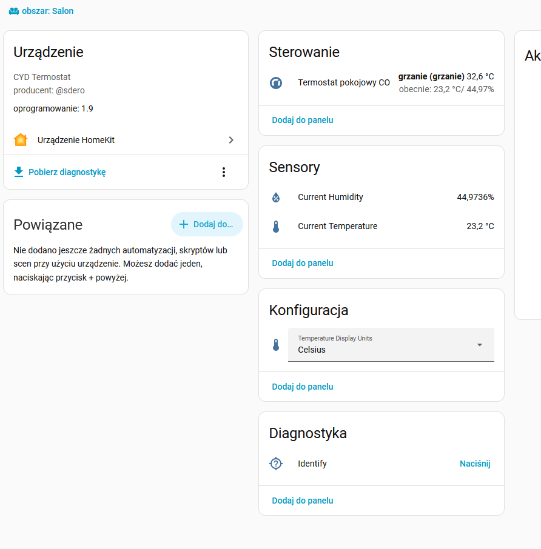

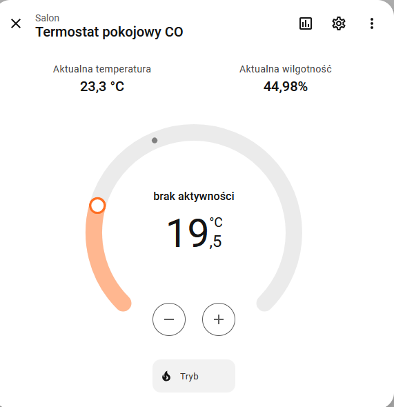

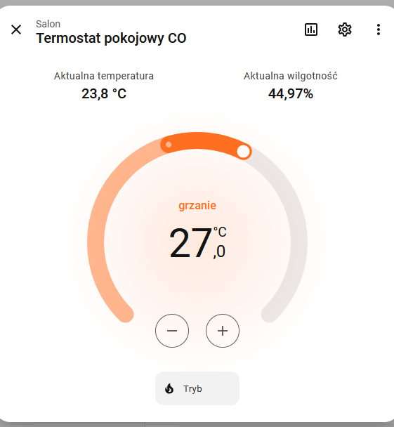

---

**Warning:** Connect the relay contacts only to the appropriate boiler control input, as specified in the manufacturer's documentation. Do not apply voltage to an input intended for volt-free control. The 230 V-powered section requires safe assembly and appropriate insulation.

------------------------------------------

## Building and flashing firmware (Windows 11 / macOS)

The project uses **Visual Studio Code + PlatformIO**. Arduino IDE is not required.

### 1. Preparing the environment

1. Install [Visual Studio Code](https://code.visualstudio.com/).
2. Open **Extensions** in VS Code and install the **PlatformIO IDE** extension.
3. Restart VS Code if required.
4. Open the project directory containing `platformio.ini`.

PlatformIO will automatically download the ESP32 framework, compiler, and libraries specified in the project configuration. The first build requires internet access.

### 2. Configuring the encryption key

Before building, generate your own 32-byte AES-256 key as described earlier.

Put the **same key** in the Master and Slave `SecureLink.h` files. Do not publish the actual key in the repository.

### 3. Building the Master (NiceMCU ESP32)

1. Open the main project directory in VS Code.
2. In PlatformIO, select **Project Tasks → Build** or click the `✓` icon on the bottom bar.
3. After compilation, a `SUCCESS` message should appear.

The firmware is located at:

```text
.pio/build/<environment_name>/firmware.bin
```

### 4. Building the Slave (ESP32-C3 SuperMini)

1. Open the `TermReg-Slave` directory as a separate PlatformIO project.
2. Verify that its AES-256 key matches the Master's key.
3. Run **Project Tasks → Build**.

### 5. Flashing the firmware

1. Connect the ESP32 to your computer using a USB cable capable of data transfer.
2. In PlatformIO, select **Project Tasks → Upload**.
3. Wait for the `SUCCESS` message.

If PlatformIO does not detect the port automatically, you can specify it in `platformio.ini`.

Windows 11:

```ini
upload_port = COM5
```

macOS:

```ini
upload_port = /dev/cu.usbserial-XXXX
```

The port names are examples. Depending on the board, a suitable USB-UART driver (such as CH340 or CP210x) may be required.

### 6. Diagnostics

Device messages can be viewed using **PlatformIO → Project Tasks → Monitor**.

Program diagnostics can be enabled by setting `DIAG=1` in the build configuration.

**Important:** The Master and Slave must be built and flashed separately. Both modules must use the same encryption key.

------------------------------

The complete system was tested with an MPM Wood Pell 14 kW boiler using an ecoMAX850 controller and a Sztoker Pellet 12 kW boiler using a mini-PID controller.

> ❤️ **P.S. Special thanks to my beloved sister Magdalena** for providing access to her Sztoker Pellet boiler and meticulously carrying out the tests! 😉
